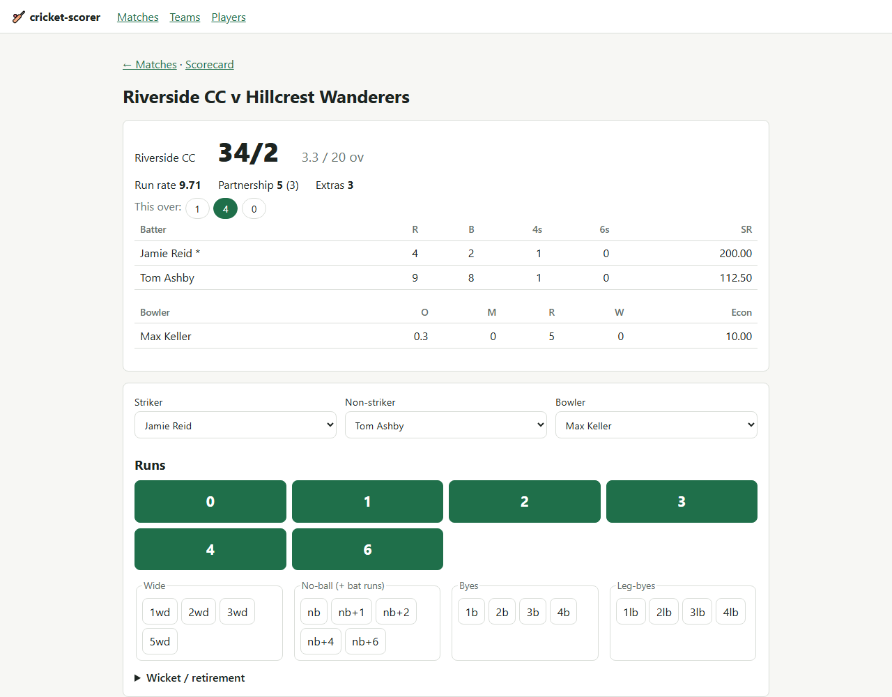
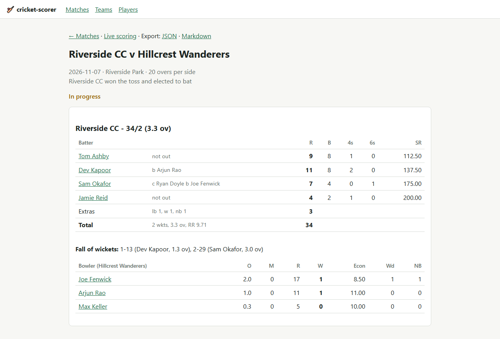

# cricket-scorer

[](https://github.com/Shahid-Ul-Islam/cricket-scorer/actions/workflows/ci.yml)

Ball-by-ball cricket scoring and statistics for amateur clubs playing limited-overs matches.
Server-rendered with FastAPI, Jinja2 and HTMX: no JavaScript build step, one SQLite file,
and a scoring page designed for a phone at the boundary.

## Features

- **Live scoring:** choose striker, non-striker and bowler, then tap **0 1 2 3 4 6**, wides,
  no-balls, byes, leg-byes or record a wicket. **Undo** removes the last ball, even after the
  innings or match has ended.
- **Live scoreboard:** score, overs, run rate, target, runs needed, required rate, current
  partnership, free-hit indicator and this over's balls.
- **Laws of the game:**
  - Wides and no-balls are re-bowled and carry a one-run penalty.
  - Runs off a no-ball go to the batter, who is credited with a ball faced.
  - Byes and leg-byes aren't charged to the bowler.
  - A **free hit** follows every no-ball and carries over wides.
  - Strike changes on odd runs and at the end of each over.
  - A bowler can't bowl consecutive overs (an optional per-bowler cap is available).
  - Each dismissal is only allowed where it's possible: on a no-ball, only run out; on a wide,
    stumped, run out or hit wicket; on a free hit, only run out.
  - The innings ends on overs, all out, or the target being reached.
- **Dismissals:** bowled, caught, lbw, run out (either batter, with runs completed), stumped,
  hit wicket, **retired hurt** (not a wicket, and the batter may resume) and **retired out**.
- **Scorecards:** batting and bowling cards, extras breakdown, fall of wickets and the result
  (won by runs, won by wickets, or tie).
- **Player stats** from completed matches:
  - Batting: innings, not outs, runs, highest score, average, strike rate, 50s and 100s.
  - Bowling: overs, wickets, best figures, average and economy.
- **Export:** a full match as JSON (every ball, enough to replay the match) and the scorecard
  as Markdown.
- **Privacy:** players are stored by name only. No personal data is collected.

## Screenshots

**Live scoring:** scoreboard, this over, batters and bowler, and the scoring buttons.



**Scorecard:** batting card with dismissals, extras, total, fall of wickets and the bowling card.



## Quick start

Requires Python 3.12+.

```bash
git clone https://github.com/Shahid-Ul-Islam/cricket-scorer.git
cd cricket-scorer
python -m venv .venv
# Windows: .venv\Scripts\activate    macOS/Linux: source .venv/bin/activate
pip install -e ".[dev]"
cricket-scorer            # or: python -m cricket_scorer --reload
```

Open <http://127.0.0.1:8000>. Matches are stored in `cricket_scorer.db` in the current
directory. To use a different database, set `CRICKET_SCORER_DATABASE_URL`:

```bash
CRICKET_SCORER_DATABASE_URL=sqlite:////srv/club/scores.db cricket-scorer --host 0.0.0.0
```

### Scoring a match

1. **Teams:** add both teams and their players.
2. **Matches → New match:** pick the teams, overs per side and players per side, and
   optionally set a maximum number of overs per bowler.
3. **Toss:** record who won and what they chose. Scoring starts immediately.
4. **Score:** choose the opening batters and the bowler, then tap a button for each ball:
   - The striker, non-striker and current bowler are filled in for you.
   - After a wicket, choose the incoming batter.
   - At the start of each over, choose the new bowler.
5. The second innings starts automatically, and the result is recorded when the match ends.
6. Use **End innings** only when no more batters can come in, for example when retired-hurt
   players can't resume.

## Architecture

```
src/cricket_scorer/
  engine/        Pure scoring engine (no I/O)
    types.py     BallEvent, ExtraType, DismissalType, InningsConfig
    innings.py   Innings: validates and replays events -> full innings state
  models.py      SQLAlchemy models: Team, Player, Match, Innings, Over, Ball
  db.py          Engine / session helpers (SQLite)
  services/      Match lifecycle, scorecard, career stats, JSON/Markdown export
  web/           FastAPI app factory, routes, Jinja2 templates, static (htmx, CSS)
tests/
  engine/        Rules: strike rotation, extras, free hit, overs, dismissals, undo
  test_*.py      Services, exports and routes (FastAPI TestClient)
```

The engine is **event-sourced**: an innings is a list of ball events, and its state (score,
strike, bowler figures, partnership, free hit and so on) comes from replaying them. Each new
event is validated against the current state before it's stored, so stored data can always be
replayed. Undo deletes the last event and replays the rest. The engine has no dependencies and
is tested in isolation.

### HTTP endpoints

| Path | Purpose |
|---|---|
| `/matches`, `/matches/new` | Match list, create match |
| `/matches/{id}/score` | Live scoring page (HTMX) |
| `/matches/{id}/scorecard` | Scorecard |
| `/matches/{id}/export.json` | Full match export (JSON, `schema_version` 1) |
| `/matches/{id}/scorecard.md` | Scorecard as Markdown |
| `/teams`, `/teams/{id}` | Teams and players |
| `/players`, `/players/{id}` | Leaderboard and career stats |

## Development

```bash
pytest                 # engine, service and route tests
ruff check .           # lint
ruff format .          # format
python scripts/make_screenshots.py   # regenerate README screenshots (needs Chrome or Edge)
```

CI (GitHub Actions) runs `ruff check`, `ruff format --check` and `pytest` on every push and
pull request. Changes are recorded in [CHANGELOG.md](CHANGELOG.md), and commits follow
[Conventional Commits](https://www.conventionalcommits.org/).

### Known limitations

- Runs taken off a no-ball are always credited to the bat. No-ball byes and leg-byes aren't
  modelled yet.
- Penalty runs, other dismissal types (obstructing the field, timed out) and mid-over bowler
  changes are not supported.
- There is no playing XI selection: any squad member can bat or bowl.
- The database schema is created with `create_all`, without migrations.

## Roadmap

- **DLS:** Duckworth–Lewis–Stern par scores and revised targets for interrupted matches.
- **Tournaments:** leagues and knockouts, points tables and net run rate.
- **Charts:** run-rate worm, Manhattan (runs per over), wagon wheel and partnership charts.
- Playing XI selection and batting order.
- JSON import to restore a match from an export.
- No-ball byes, penalty runs and other dismissal types.
- Alembic migrations.
- Multi-user scoring with live spectator view.

## License

[MIT](LICENSE) © 2026 Shahid Ul Islam
